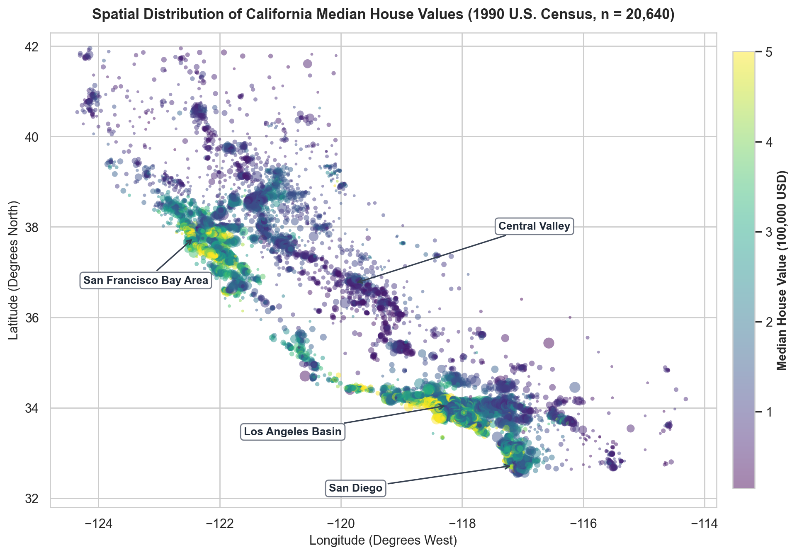
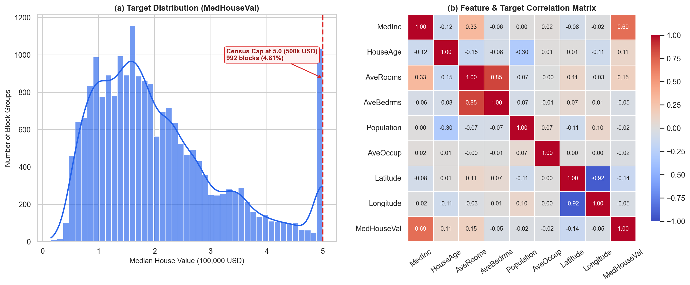
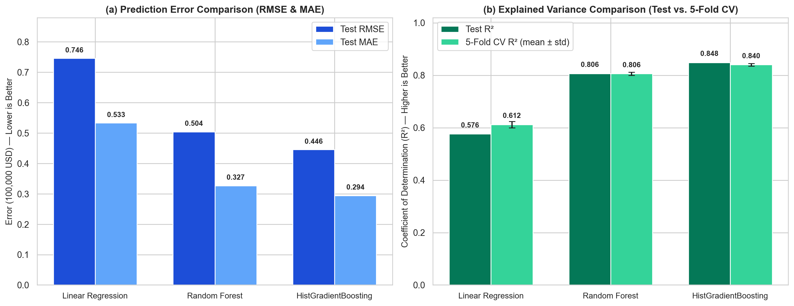
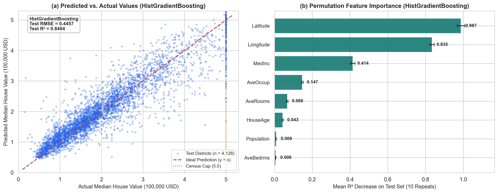

# HouseValue-ML: Predicting California Real Estate Prices and Analyzing Housing Market Trends

## Team

| Member | Department | Email |
| :--- | :--- | :--- |
| **Corentin Lepeltier** | Computer Science | `corentin.lepeltier@edu.ece.fr` |
| **Gabin Flotat** | Computer Science | `gabin.flotat@edu.ece.fr` |
| **Roméo Poncelet** | Computer Science | `romeo.poncelet@edu.ece.fr` |

---

## Table of Contents

| Section | Topic | Highlights |
| :---: | :--- | :--- |
| **I** | [**Introduction**](#i-introduction) | Motivation, real estate context & expected outcomes |
| **II** | [**Datasets**](#ii-datasets) | California Housing overview, statistics & EDA findings |
| **III** | [**Methodology**](#iii-methodology) | 5-stage pipeline, leak-free preprocessing, models & inference |
| **IV** | [**Evaluation & Analysis**](#iv-evaluation--analysis) | Quantitative benchmark, diagnostic plots & feature importance |
| **V** | [**Related Work & References**](#v-related-work--references) | Academic papers, foundational references & libraries |
| **VI** | [**Conclusion & Next Steps**](#vi-conclusion--next-steps) | Stage A summary & Stage B roadmap |
| **—** | [**Repository Structure & Setup**](#repository-structure--setup) | Project layout & local reproduction steps |

---

## I. Introduction

### Motivation
Real estate valuation sits at the intersection of economics, urban geography, and applied machine learning. Unlike uniform financial assets, residential properties are heterogeneous goods whose value depends simultaneously on **neighborhood affluence**, **dwelling characteristics** (size, building age, household density), and **spatial location** (coastal proximity, access to major employment hubs). Traditional manual appraisals can be slow, subjective, and difficult to scale across thousands of neighborhoods.

By building a transparent, reproducible **Machine Learning regression pipeline** with `scikit-learn`, this project seeks to quantify how socioeconomic and geographic factors jointly shape housing prices across California and to benchmark linear baselines against modern tree-based ensembles.

### Expected Outcomes
By the completion of the project, we aim to deliver:
1. **Market Trend Insights:** Visual and quantitative evidence explaining which geographic clusters and socioeconomic attributes drive California real estate valuations.
2. **Model Benchmark:** A rigorous, leak-free comparison between **Multiple Linear Regression**, **Random Forest**, and **Histogram-based Gradient Boosting** using both hold-out testing and 5-fold cross-validation.
3. **Diagnostic Error Analysis:** Clear identification of model limitations, including the impact of right-censored census records (`500,000 USD` cap) and spatial non-linearities.
4. **Reusable Inference Function:** A clean prediction API (`predict_house_value`) capable of estimating median house prices for custom district profiles in real time.

---

## II. Datasets

### Dataset Overview
This study uses the **California Housing Dataset**, originally compiled by Pace and Barry (1997) from the **1990 U.S. Census** and distributed via `sklearn.datasets.fetch_california_housing`. Each observation corresponds to one census block group (the smallest geographical unit for which the U.S. Census Bureau publishes sample data, typically covering 600 to 3,000 residents).

- **Total Observations:** `20,640` census block groups
- **Input Features:** `8` continuous numerical attributes (`0` missing values across all columns)
- **Target Variable (`MedHouseVal`):** Median house value in the block group, measured in units of `100,000 USD` (ranging from `0.1500` [15,000 USD] to `5.0000` [500,000 USD], with mean `2.0686` and median `1.7970`)
- **Censoring Note:** Exactly **`992` block groups (`4.81%`)** are capped at the maximum census threshold of `5.0000` (`500,000 USD`).

### Features Dictionary & Descriptive Statistics

The table below combines the semantic definition of each variable with its exact empirical statistics computed across all `20,640` block groups and its Pearson correlation (`r`) with `MedHouseVal`:

| Variable | Description (Unit) | Mean | Std Dev | Min | Median | Max | Corr. with Target (`r`) |
| :--- | :--- | ---: | ---: | ---: | ---: | ---: | ---: |
| `MedInc` | Median household income (10,000 USD) | 3.8707 | 1.8998 | 0.4999 | 3.5348 | 15.0001 | **+0.6881** |
| `HouseAge` | Median house age in block group (years) | 28.6395 | 12.5856 | 1.0000 | 29.0000 | 52.0000 | +0.1056 |
| `AveRooms` | Average rooms per household (count) | 5.4290 | 2.4742 | 0.8462 | 5.2291 | 141.9091 | +0.1519 |
| `AveBedrms` | Average bedrooms per household (count) | 1.0967 | 0.4739 | 0.3333 | 1.0488 | 34.0667 | -0.0467 |
| `Population` | Total block group population (residents) | 1,425.48 | 1,132.46 | 3.00 | 1,166.00 | 35,682.00 | -0.0246 |
| `AveOccup` | Average household occupancy (persons) | 3.0707 | 10.3860 | 0.6923 | 2.8181 | 1,243.3333 | -0.0237 |
| `Latitude` | Geographic latitude (degrees North) | 35.6319 | 2.1360 | 32.5400 | 34.2600 | 41.9500 | -0.1442 |
| `Longitude` | Geographic longitude (degrees West) | -119.5697 | 2.0035 | -124.3500 | -118.4900 | -114.3100 | -0.0460 |
| **`MedHouseVal`** | **Target: Median house value (100,000 USD)** | **2.0686** | **1.1540** | **0.1500** | **1.7970** | **5.0000** | **1.0000** |

### Exploratory Data Analysis (EDA) Findings


*Figure 1: Spatial map of California census block groups (`n = 20,640`), colored by median house value (`100,000 USD`) and sized by block population.*


*Figure 2: (a) Distribution of `MedHouseVal` highlighting the artificial `500,000 USD` census ceiling (`992` blocks, `4.81%`); (b) full Pearson correlation matrix.*

Three market insights stand out immediately from exploratory analysis:
1. **Strong Coastal & Metropolitan Premium:** Figure 1 shows concentrated high-price zones along the **San Francisco Bay Area**, **Los Angeles Basin**, and **San Diego** coastline, contrasted with substantially lower valuations across the inland **Central Valley**.
2. **Income Dominates Linear Signal, While Location Is Non-Linear:** `MedInc` is by far the strongest single linear predictor (`r = +0.6881`). In contrast, `Latitude` (`r = -0.1442`) and `Longitude` (`r = -0.0460`) exhibit weak linear correlation individually because expensive markets appear at multiple distinct coastal latitudes (Bay Area near 37.8°N and Southern California near 33°N–34°N).
3. **Heavy-Tailed Structural Ratios & Target Capping:** `AveRooms` (max `141.91`) and `AveOccup` (max `1,243.33`) contain extreme block-group outliers (such as vacation resorts or institutional housing), while `MedHouseVal` displays a sharp artificial spike at `5.0` (`500,000 USD`).

---

## III. Methodology

### End-to-End Pipeline Architecture

The workflow in `train.py` and `housing_prediction.ipynb` follows a modular 5-stage structure:

1. **Data Ingestion & Profiling** — Load `fetch_california_housing(as_frame=True)`, verify schema and missingness (`0` nulls), and compute descriptive statistics.
2. **Leak-Free Splitting & Scaling** — Apply an `80% / 20%` train-test partition (`16,512` train / `4,128` test, `random_state=42`) before any parameter estimation.
3. **Model Training & 5-Fold CV** — Benchmark three regression families using consistent `KFold(n_splits=5, shuffle=True, random_state=42)` on the training split.
4. **Quantitative & Visual Evaluation** — Measure test error (`MAE`, `MSE`, `RMSE`), explained variance (`R² Score`), and test-set permutation feature importance.
5. **Single-Sample Inference** — Persist the top model via `joblib` and expose `predict_house_value(model, sample_features)`.

### Preprocessing & Leak-Free Design
Because `LinearRegression` relies on feature scale for numerical stability and coefficient comparability, we encapsulate `StandardScaler()` inside a `scikit-learn` `Pipeline` (`[("scaler", StandardScaler()), ("model", LinearRegression())]`). Fitting the scaler exclusively inside each training fold prevents data leakage from the test set. Tree-based ensembles (`RandomForestRegressor` and `HistGradientBoostingRegressor`) are invariant to monotonic feature scaling and therefore ingest raw tabular features directly.

### Choice of Algorithms
We selected three complementary regression families to compare linear simplicity against bagging and boosting ensembles:

| Model Family | `scikit-learn` Configuration | Rationale |
| :--- | :--- | :--- |
| **Linear Baseline** | `Pipeline([StandardScaler, LinearRegression])` | Fast, closed-form Ordinary Least Squares (OLS) baseline; establishes how much variance a purely additive linear hyperplane can explain. |
| **Bagging Ensemble** | `RandomForestRegressor(n_estimators=200, random_state=42)` | Aggregates 200 decorrelated decision trees; captures non-linear coordinate interactions (`Latitude` × `Longitude`) and resists extreme feature outliers. |
| **Gradient Boosting** | `HistGradientBoostingRegressor(max_iter=300, learning_rate=0.08, max_leaf_nodes=31, random_state=42)` | Histogram-binned sequential tree boosting inspired by LightGBM; iteratively corrects residual spatial and income errors with high accuracy and fast training. |

### Evaluation Metrics
Models are compared using four standard regression metrics (reported in `100,000 USD` units and equivalent USD):
- **MAE (Mean Absolute Error):** Average absolute deviation between predicted and true district values (intuitive average dollar error).
- **MSE (Mean Squared Error):** Average squared error, penalizing large valuation misses more heavily.
- **RMSE (Root Mean Squared Error):** Square root of MSE, expressed in the same `100,000 USD` scale as `MedHouseVal`.
- **R² Score (Coefficient of Determination):** Proportion of housing price variance explained by the model (`1.0` indicates perfect prediction).

### Single-Sample Inference Demonstration
To validate practical usability, `predict_house_value()` formats an 8-feature dictionary into a feature-ordered DataFrame and converts the model prediction back to USD (`prediction × 100,000`):

- **Coastal Bay Area Profile** (`MedInc = 7.80`, `HouseAge = 32`, `AveRooms = 6.40`, `AveBedrms = 1.08`, `Population = 1,150`, `AveOccup = 2.60`, `Latitude = 37.75`, `Longitude = -122.42`):
  Predicted Median House Value = **441,008.02 USD** (`4.4101 × 100k USD`).
- **Inland Central Valley Profile** (`MedInc = 3.10`, `HouseAge = 22`, `AveRooms = 5.10`, `AveBedrms = 1.05`, `Population = 1,600`, `AveOccup = 3.10`, `Latitude = 36.75`, `Longitude = -119.77`):
  Predicted Median House Value = **72,920.19 USD** (`0.7292 × 100k USD`).

---

## IV. Evaluation & Analysis

### Quantitative Model Benchmark

All three candidate models were trained on the same `16,512` training samples and evaluated on the identical `4,128` held-out test districts (`random_state=42`):

| Model | Test MAE (`100k USD`) | Test MAE (USD) | Test MSE | Test RMSE (`100k USD`) | Test RMSE (USD) | Test R² | 5-Fold CV R² (Mean ± Std) | Fit Time |
| :--- | ---: | ---: | ---: | ---: | ---: | ---: | ---: | ---: |
| **Linear Regression** | 0.5332 | 53,320 USD | 0.5559 | 0.7456 | 74,558 USD | 0.5758 | 0.6115 ± 0.0124 | 0.009 s |
| **Random Forest** | 0.3266 | 32,659 USD | 0.2539 | 0.5039 | 50,391 USD | 0.8062 | 0.8058 ± 0.0063 | 4.052 s |
| **HistGradientBoosting** | **0.2945** | **29,454 USD** | **0.1987** | **0.4457** | **44,571 USD** | **0.8484** | **0.8400 ± 0.0046** | 3.292 s |


*Figure 3: (a) Test RMSE and MAE comparison across the three regression families; (b) Hold-out Test R² alongside 5-Fold Cross-Validation R² (mean ± standard deviation).*

### Diagnostic Analysis & Feature Importance


*Figure 4: (a) Predicted vs. Actual `MedHouseVal` on the `4,128` test districts for `HistGradientBoosting`; (b) Test-set permutation feature importance (10 repeats).*

#### Permutation Feature Importance (`HistGradientBoosting` on Test Set)

| Rank | Feature | Mean R² Decrease | Std Dev | Market Interpretation |
| :---: | :--- | ---: | ---: | :--- |
| 1 | `Latitude` | **0.9875** | 0.0207 | Captures North-South coastal/urban regional zones (Bay Area vs. Central Valley vs. LA/San Diego). |
| 2 | `Longitude` | **0.8346** | 0.0115 | Captures West-to-East distance from the Pacific coastline and high-value coastal corridors. |
| 3 | `MedInc` | **0.4145** | 0.0114 | Measures local household purchasing power directly supporting higher mortgage capacity. |
| 4 | `AveOccup` | 0.1469 | 0.0044 | Reflects household density and neighborhood housing composition. |
| 5 | `AveRooms` | 0.0676 | 0.0042 | Distinguishes spacious single-family homes from smaller multi-unit dwellings. |
| 6 | `HouseAge` | 0.0431 | 0.0024 | Encodes historic established neighborhoods versus newer suburban developments. |
| 7 | `Population` | 0.0087 | 0.0006 | Minor proxy for local urban density within a block group. |
| 8 | `AveBedrms` | 0.0060 | 0.0013 | Strongly collinear with `AveRooms` (`r = 0.85`), contributing minimal independent signal. |

#### Key Analytical Takeaways
1. **Substantial Non-Linear Gain:** Transitioning from `LinearRegression` (`RMSE = 0.7456`, `R² = 0.5758`) to `HistGradientBoosting` (`RMSE = 0.4457`, `R² = 0.8484`) cuts test RMSE by **29,987 USD (`40.2%`)** and explains an additional **27.3 percentage points** of price variance. The close alignment between 5-Fold CV R² (`0.8400 ± 0.0046`) and Test R² (`0.8484`) confirms strong generalization with negligible overfitting.
2. **Why Geography Leads Permutation Importance:** Although `Latitude` and `Longitude` have near-zero linear correlations (`-0.1442` and `-0.0460`), permuting either coordinate on the test set causes `R²` to drop by `0.9875` and `0.8346`, respectively — more than double the permutation drop of `MedInc` (`0.4145`). This proves that tree ensembles exploit **2D geographic interactions** that linear models cannot represent.
3. **Ceiling Distortion at 500,000 USD:** Figure 4(a) clearly shows a vertical wall of points at `Actual = 5.0` where predictions span roughly `3.4` to `5.1`. Because luxury districts above `500,000 USD` were artificially truncated during the 1990 Census, the model faces irreducible uncertainty near the upper cap.

---

## V. Related Work & References

1. **Original Dataset & Spatial Modeling:** Pace, R. K., & Barry, R. (1997). *Sparse Spatial Autoregressions*. Statistics & Probability Letters, 33(3), 291–297.
2. **Foundational ML Workflow Reference:** Géron, A. (2022). *Hands-On Machine Learning with Scikit-Learn, Keras, and TensorFlow* (3rd ed.). O'Reilly Media — Chapter 2 ("End-to-End Machine Learning Project" using California Housing).
3. **Core Libraries & Documentation:**
   - `scikit-learn`: [California Housing Dataset](https://scikit-learn.org/stable/datasets/real_world.html#california-housing-dataset), [HistGradientBoostingRegressor](https://scikit-learn.org/stable/modules/generated/sklearn.ensemble.HistGradientBoostingRegressor.html), [RandomForestRegressor](https://scikit-learn.org/stable/modules/generated/sklearn.ensemble.RandomForestRegressor.html), [Permutation Importance](https://scikit-learn.org/stable/modules/permutation_importance.html).
   - `pandas` & `NumPy`: Tabular preprocessing and vectorized numerical metrics.
   - `Matplotlib` & `Seaborn`: High-resolution spatial scatter maps, correlation matrices, and model diagnostics.

---

## VI. Conclusion & Next Steps

### Stage A Summary
At Stage A, we established an end-to-end, leak-free Machine Learning pipeline (`train.py` and `housing_prediction.ipynb`) for California real estate price prediction. Exploratory analysis confirmed that coastal proximity, local median income, and census censoring at `500,000 USD` govern the market landscape. Across our benchmark on `4,128` held-out test districts, `HistGradientBoostingRegressor` achieved the best accuracy (**RMSE = 44,571 USD**, **MAE = 29,454 USD**, **R² = 0.8484**) and demonstrated realistic predictions on contrasting Coastal Bay Area (**441,008 USD**) and Inland Central Valley (**72,920 USD**) profiles.

### Stage B Roadmap (Final Submission & Oral Presentation)
Before the final Stage B deadline, we plan to extend this baseline with:
1. **Domain Feature Engineering:** Derive `RoomsPerHousehold`, `BedroomsRatio` (`AveBedrms / AveRooms`), `PopulationPerHousehold`, and exact Haversine distances to **San Francisco** and **Los Angeles**.
2. **Censoring Ablation Study:** Quantify how removing or separately modeling the `992` capped districts (`MedHouseVal = 5.0`) alters RMSE and residual symmetry.
3. **Hyperparameter Optimization:** Run `RandomizedSearchCV` on `HistGradientBoostingRegressor` (`max_iter`, `learning_rate`, `max_leaf_nodes`, `l2_regularization`, `min_samples_leaf`) and inspect residual spatial maps.
4. **Final Academic Polish & Presentation Video:** Format the complete 4+ page double-column final report and record the under-10-minute presentation walkthrough (Task 2).

---

## Repository Structure & Setup

```text
HouseValue-ML/
├── .gitignore                 # Ignore caches, venvs, and serialized model binaries
├── LICENSE                    # MIT License
├── README.md                  # Concise project overview & link to the full blog
├── blog.md                    # Full ITE 351 Tech Blog (Stage A)
├── requirements.txt           # Python dependencies
├── train.py                   # Reproducible ML training, CV, plotting & inference script
├── housing_prediction.ipynb   # Interactive Jupyter notebook walkthrough
├── assets/
│   └── figures/               # Publication-quality EDA & evaluation figures
│       ├── 01_california_housing_map.png
│       ├── 02_target_distribution_and_correlations.png
│       ├── 03_model_comparison.png
│       └── 04_predicted_vs_actual_and_importance.png
└── results/
    └── metrics.json           # Exact descriptive stats, CV/test metrics & inference logs
```

### Local Reproduction

```bash
# 1. Clone the repository
git clone https://github.com/Gab1-Flt/HouseValue-ML.git
cd HouseValue-ML

# 2. Create and activate a virtual environment
python3 -m venv venv
source venv/bin/activate   # On Windows PowerShell: venv\Scripts\Activate.ps1

# 3. Install dependencies and run the full pipeline
pip install -r requirements.txt
python3 train.py
```

---

## License

This project is licensed under the [MIT License](LICENSE).
